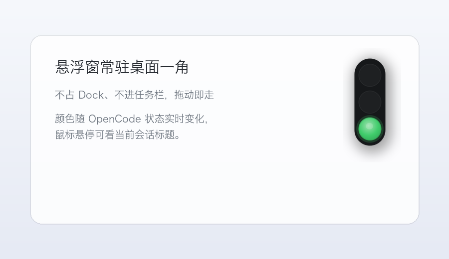
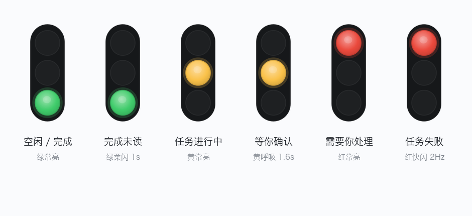

# OpenCode 红绿灯 · 使用说明书

> 桌面上的一盏交通灯，替你盯着 OpenCode。
>
> 它不占 Dock、不进任务栏，只用三种颜色和三种闪烁告诉你一件事：**现在需要你，还是不需要。**



> 配图由 App 内置的 `--export` 直接从绘制管线导出（非屏摄），桌面场景为示意合成。

| 项目 | 说明 |
| --- | --- |
| 支持平台 | macOS 13+（Apple Silicon / Intel）、Windows 10 / 11 |
| 实现 | macOS：Swift + AppKit；Windows：C# + WinForms（单文件 96 KB） |
| 依赖 | 无第三方依赖；Windows 使用系统自带 .NET Framework 4.8 |
| 数据来源 | 只读 OpenCode 本地服务 API（`127.0.0.1`），不上传任何数据 |
| 轮询频率 | 每 1.2 秒一次 |
| 安装方式 | macOS：`Install.command`；Windows：`install.ps1` |

---

## 目录

1. [它解决什么问题](#1-它解决什么问题)
2. [灯语速查](#2-灯语速查)
3. [六种灯态详解](#3-六种灯态详解)
4. [安装](#4-安装)
5. [日常操作](#5-日常操作)
6. [状态是怎么算出来的](#6-状态是怎么算出来的)
7. [自检与调灯](#7-自检与调灯)
8. [故障排查](#8-故障排查)
9. [隐私与资源占用](#9-隐私与资源占用)
10. [卸载](#10-卸载)
11. [附录](#11-附录)

---

## 1. 它解决什么问题

用 OpenCode 干活时，最常见的动作是「切回终端看一眼它好了没」。这个动作一天要重复几十次，每次都会打断当前思路。

红绿灯把「看一眼」的成本降到零：

- **不用切窗口**：余光扫一眼屏幕角落即可
- **不用读文字**：颜色和闪烁节奏本身就是信息
- **不会漏掉等待**：权限请求、表单确认会主动亮红灯/黄呼吸
- **不会误判完成**：任务刚完成时绿灯柔闪，提醒你回来看结果

它只做一件事：把 OpenCode 的会话状态翻译成灯。不接管操作、不写任何数据、不联网。

---

## 2. 灯语速查



| 灯态 | 含义 | 一句话判断 |
| --- | --- | --- |
| 🟢 绿灯常亮 | 空闲 / 全部完成 | 可以走开 |
| 🟢 绿灯柔闪（1 秒一呼一吸） | 刚完成、你还没查看 | 回来看结果 |
| 🟡 黄灯常亮 | 任务进行中 | 等它干完 |
| 🟡 黄灯呼吸（1.6 秒一呼一吸） | 等你确认（表单 / 提问） | 需要点一下 |
| 🔴 红灯常亮 | 需要你处理（权限请求） | 需要做决定 |
| 🔴 红灯快闪（2 Hz） | 任务失败 | 出事了 |
| 🔴 红灯常亮（无连接） | 服务未连接 / 读不到状态 | 看悬停文案 |

**只有三种闪烁**，且各有明确含义，其余状态一律常亮——这样任何一次闪动都不会被误读：

| 闪烁 | 周期 | 亮度范围 | 语义 |
| --- | --- | --- | --- |
| 黄呼吸 | 1.6 s | 34% → 100% | 等你，不紧急 |
| 红快闪 | 2 Hz（亮 0.3 s / 灭 0.2 s） | 100% / 18% | 故障，最醒目 |
| 绿柔闪 | 1.0 s | 52% → 100% | 完成未读，温和提醒 |

---

## 3. 六种灯态详解

### 3.1 🟢 绿灯常亮 —— 空闲 / 全部完成


| 项目 | 说明 |
| --- | --- |
| 触发条件 | 没有运行中的会话，也没有待办；最近会话已完成且你看过（或已超过 90 秒） |
| 悬停文案 | `全部完成` + 最近会话标题；若没有会话则显示「当前没有会话」 |
| 典型场景 | 干完一轮活，回到电脑前；刚打开 OpenCode 还没开始 |
| 持续时间 | 一直保持，直到出现新任务 |

### 3.2 🟢 绿灯柔闪 —— 完成未读


| 项目 | 说明 |
| --- | --- |
| 触发条件 | 最近一次顶层会话 `outcome = succeeded`，完成时间在 **90 秒**内，且 `time.viewed < time.idle`（你还没打开看过） |
| 悬停文案 | `任务完成` + 「最近一次会话已完成，等你查看」+ 会话标题 |
| 区别于绿灯常亮 | 常亮 = 你看过了或已经放了很久；柔闪 = 新鲜结果，值得回来看 |
| 停止方式 | 打开该会话（OpenCode 会更新 `viewed`），或 90 秒后自动转常亮 |

> 这是 v2 新增的灯态。判断依据不是「有没有新消息」，而是**你看没看过**：只要你看过，灯就不再闪。

### 3.3 🟡 黄灯常亮 —— 任务进行中


| 项目 | 说明 |
| --- | --- |
| 触发条件 | `GET /api/session/active` 返回至少一个运行中的会话 |
| 悬停文案 | `任务进行中` + 「N 个会话正在运行」+ 最多 6 个会话标题 |
| 典型场景 | 让它写代码、跑测试、查资料；你去做别的事 |
| 持续时间 | 直到会话结束 |

### 3.4 🟡 黄灯呼吸 —— 等你确认


| 项目 | 说明 |
| --- | --- |
| 触发条件 | 某个会话存在状态为 `pending` 的表单/提问（`/form` 列表 + 详情 `state.status = pending`） |
| 悬停文案 | `等待你确认` + 「确认请求：<表单标题>」+ 会话标题 |
| 为什么是呼吸而不是快闪 | 它在等你，但没有出错，不需要惊吓式提醒 |
| 处理方式 | 回到 OpenCode 回答该表单；灯会自动转回黄常亮或绿常亮 |

### 3.5 🔴 红灯常亮 —— 需要你处理


| 项目 | 说明 |
| --- | --- |
| 触发条件（正常） | 某个会话存在待处理的**权限请求**（`/permission` 返回非空） |
| 悬停文案 | 单个请求时显示「权限请求：<动作>」+ 会话标题；多个时显示「N 个权限请求待处理」 |
| 触发条件（异常） | 找不到 `service.json`，或 API 读不到状态 |
| 异常时的悬停文案 | `未找到 OpenCode 服务` / `无法读取 OpenCode 状态` + 排查提示 |
| 如何区分 | **看悬停文案**：正常权限请求会写明动作；异常会写明连接问题 |

> 这是唯一一个「两种原因共用同一种灯」的状态。把鼠标放上去 0.3 秒，文案会直接告诉你是哪一种。

### 3.6 🔴 红灯快闪 —— 任务失败


| 项目 | 说明 |
| --- | --- |
| 触发条件 | 最近一次顶层会话 `outcome = failed`，且距最后更新时间在 **10 分钟**内 |
| 悬停文案 | `任务失败` + 「最近一次会话以失败结束」+ 会话标题 |
| 为什么区分常亮/快闪 | 失败需要你立刻知道，但又不该和权限请求混淆 |
| 停止方式 | 10 分钟后自动结束（转绿）；或开始新任务（转黄） |

---

## 4. 安装

### 4.1 macOS

**方式一：下载预编译包**

1. 到 [Releases](https://github.com/zhaoleixxx/OpenCodeTrafficLight/releases) 下载 `OpenCodeTrafficLight-2.0.0-macos.zip`
2. 解压，双击 `Install.command`
3. 首次打开若提示「无法验证开发者」：右键点击 → 选择「打开」→ 再点「打开」

**方式二：从源码构建**

```bash
git clone https://github.com/zhaoleixxx/OpenCodeTrafficLight.git
cd OpenCodeTrafficLight
./build.sh          # 需要 Xcode Command Line Tools
open Install.command
```

安装脚本会做三件事：

| 动作 | 位置 |
| --- | --- |
| 复制应用 | `~/Applications/OpenCodeTrafficLight.app` |
| 复制守护脚本 | `~/Library/Application Support/OpenCodeTrafficLight/watcher.sh` |
| 注册登录自启 | `~/Library/LaunchAgents/local.opencode.trafficlight.plist` |

### 4.2 Windows

**方式一：下载预编译包**

1. 下载 `OpenCodeTrafficLight-2.0.0-windows.zip` 并解压
2. 右键 `install.ps1` → **使用 PowerShell 运行**
3. 若被执行策略拦截：

```powershell
powershell -ExecutionPolicy Bypass -File .\install.ps1
```

**方式二：从源码构建**（macOS / Linux 也可交叉编译）

```bash
cd Windows
./build.sh          # 产物：dist/OpenCodeTrafficLight.exe
```

安装脚本会：

| 动作 | 位置 |
| --- | --- |
| 复制程序 | `%LOCALAPPDATA%\Programs\OpenCodeTrafficLight\` |
| 注册登录自启 | `HKCU\Software\Microsoft\Windows\CurrentVersion\Run` |
| 立即启动 | 悬浮窗 + 托盘图标 |

首次运行会有 SmartScreen 提示（未做代码签名），点「更多信息」→「仍要运行」。

### 4.3 安装之后

| 平台 | 触发显示的条件 |
| --- | --- |
| macOS | 终端里有交互式 `opencode` 进程（必须挂在真实 TTY 上） |
| Windows | 存在 `opencode` / `OpenCode` 进程，且命令行不含 `--service` |

两种情况下，后台服务 `opencode serve --service`、无 TTY 的 `opencode run` 都**不会**触发悬浮窗——它们不是一次终端会话。

---

## 5. 日常操作

### 5.1 拖动

按住悬浮窗任意位置拖动，松手即记住位置。

- 位置存在 macOS `UserDefaults` / Windows `%APPDATA%\OpenCodeTrafficLight\settings.json`
- 重启后回到上次位置
- 若显示器变化导致窗口跑到屏幕外，会自动回落到默认位置（右上角，留 16 px 边距）

### 5.2 悬停查看详情

鼠标停在灯上 0.35 秒，弹出提示：

```
OpenCode 红绿灯
需要你处理

权限请求：bash
会话：重构登录模块
```

第一行是标题，第二行是状态摘要，后面是细节。**判断灯态含义时优先看这段文案。**

### 5.3 右键菜单

| 菜单项 | 作用 |
| --- | --- |
| 立即刷新 | 跳过 1.2 秒等待，马上查询一次 |
| 打开 OpenCode | 尝试启动 OpenCode；找不到就打开官网 |
| 始终置顶 | 勾选/取消置顶（默认开启） |
| 复位位置 | 回到屏幕右上角并保存 |
| 隐藏（OpenCode 重启后恢复） | 本次不再自动出现，最长 15 分钟；OpenCode 全部退出后重新启动会恢复 |
| 退出 | macOS：只退出悬浮窗，守护进程仍在；Windows：结束整个程序 |

### 5.4 托盘图标（仅 Windows）

Windows 版在通知区域常驻一个小红绿灯图标：

| 操作 | 作用 |
| --- | --- |
| 双击图标 | 重新显示悬浮窗 |
| 右键 → 显示红绿灯 | 同上，并解除「隐藏」暂停 |
| 右键 → 立即刷新 | 马上查询一次 |
| 右键 → 退出 | 结束程序 |

### 5.5 自动出现与消失

| 场景 | 行为 |
| --- | --- |
| 启动 OpenCode 会话 | 2 秒内悬浮窗出现 |
| 所有 OpenCode 会话退出 | 悬浮窗自动隐藏，并清除「隐藏」标记 |
| 手动点「隐藏」 | 本次不再自动出现；15 分钟后或 OpenCode 重启后恢复 |
| 登录系统 | 自动启动（LaunchAgent / Run 键） |

---

## 6. 状态是怎么算出来的

### 6.1 判定优先级

每 1.2 秒执行一次，**从上到下**匹配，命中即停：

```
1. 有权限请求？          → 🔴 红常亮
2. 有待确认表单？        → 🟡 黄呼吸
3. 有运行中会话？        → 🟡 黄常亮
4. 最近会话 10 分钟内失败？ → 🔴 红快闪
5. 最近会话 90 秒内完成且未读？ → 🟢 绿柔闪
6. 其他                  → 🟢 绿常亮
```

读不到 `service.json` 或 API 失败时，走异常分支：🔴 红常亮 + 悬停说明原因。

### 6.2 数据来源

| 接口 | 用途 |
| --- | --- |
| `GET /api/session/active` | 正在运行的会话（返回 `data` 的键集合） |
| `GET /api/session?limit=25&order=desc` | 最近 25 个会话，含 `outcome`、`time.updated`、`time.idle`、`time.viewed` |
| `GET /api/session/{id}/permission` | 该会话待处理的权限请求 |
| `GET /api/session/{id}/form` | 该会话的表单列表（不含状态） |
| `GET /api/session/{id}/form/{fid}` | 表单详情，用 `state.status == "pending"` 确认仍在等待 |

配置来自 `service.json`（含本地端口与 Basic Auth 密码）。仅接受 `127.0.0.1` / `localhost` 地址。

### 6.3 性能取舍

| 参数 | 值 | 原因 |
| --- | --- | --- |
| 轮询间隔 | 1.2 s | 足够跟手，又不至于打满 CPU |
| 单请求超时 | 2 s | 服务卡住时不拖垮下一轮 |
| 权限/表单并发查询 | 最多 8 个会话 | 只查最可能产生待办的前 8 个，避免 N 次请求 |
| 并发等待上限 | 2.8 s | 超时就用已返回的结果，不阻塞灯效 |
| 失败保持窗口 | 10 min | 让你有机会看到失败，又不至于永久红闪 |
| 完成未读窗口 | 90 s | 足够你回到电脑前看到柔闪 |

### 6.4 service.json 的查找顺序

| 平台 | 路径 |
| --- | --- |
| macOS / Linux | `~/.local/state/opencode/service.json` |
| Windows | `%XDG_STATE_HOME%\opencode\service.json` → `%USERPROFILE%\.local\state\opencode\service.json` → `%LOCALAPPDATA%\opencode\service.json` → `%LOCALAPPDATA%\opencode\state\service.json` → `%APPDATA%\opencode\service.json` → 上述目录的 `service-*.json`（取最新） |

Windows 上 OpenCode 有两套路径逻辑（XDG 回退与新版 UserDirectories），所以按顺序探测，取第一个可用且指向回环地址的文件。

---

## 7. 自检与调灯

不需要真的跑任务，也能看到全部灯效。

### macOS

```bash
# 每 3 秒轮播六种灯态
./build/OpenCodeTrafficLight --selftest

# 固定显示某一种，便于截图/调试
./build/OpenCodeTrafficLight --selftest --state=redfast
# 可选：yellow | pulse | red | redfast | greensoft | green
```

### Windows

```powershell
.\OpenCodeTrafficLight.exe --selftest
.\OpenCodeTrafficLight.exe --selftest --state=redfast
```

### 导出说明书配图（macOS）

```bash
./build/OpenCodeTrafficLight --export=docs/images
```

会生成六种灯态的透明 PNG（含闪烁的亮/暗两帧），可直接用于文档或设计稿。

---

## 8. 故障排查

### 灯一直是红灯，悬停显示「未找到 OpenCode 服务」

| 检查项 | 做法 |
| --- | --- |
| OpenCode 是否在运行 | 终端执行 `opencode` 开一个会话 |
| `service.json` 是否存在 | macOS：`ls ~/.local/state/opencode/service.json`；Windows：`dir %USERPROFILE%\.local\state\opencode\service.json` |
| 是否是旧版 OpenCode | 升级到最新版，路径与 API 有变化 |

### 灯一直是红灯，悬停显示「无法读取 OpenCode 状态」

OpenCode 服务已退出，或端口变了但 `service.json` 未更新。重启 OpenCode 即可；仍不行就删掉 `service.json` 再启动。

### 悬浮窗不出现（macOS）

`watcher.sh` 只认**挂在真实 TTY 上的交互式 CLI**：

| 情况 | 是否触发 |
| --- | --- |
| 在 Terminal / iTerm / Ghostty 里运行 `opencode` | ✅ |
| 编辑器内嵌终端运行 `opencode` | ✅（只要有 TTY） |
| `opencode serve --service` | ❌ |
| `opencode run "xxx"`（无 TTY） | ❌ |
| 桌面版 OpenCode | ❌ |

手动检查：

```bash
tail -f ~/Library/Logs/OpenCodeTrafficLight.watcher.log
```

### 悬浮窗不出现（Windows）

- 任务栏托盘里是否已有图标（可能只是被隐藏了）
- 程序是否在运行：任务管理器里找 `OpenCodeTrafficLight.exe`
- 若以管理员权限运行终端，普通权限的程序可能读不到进程命令行——两边权限保持一致

### 灯一直是黄的，但 OpenCode 看起来没在跑

某个子会话仍处于 active，或上一次请求的会话没有正确结束。打开 OpenCode 看一眼会话列表；必要时结束该会话。

### 绿灯不柔闪

两种可能：

1. 你已经打开过该会话（`viewed >= idle`），系统认为你已读
2. 完成已超过 90 秒

### 红快闪不消失

失败状态保持 10 分钟。想立即消掉，开始一个新任务（转黄）即可。

### 「隐藏」后一直不出现

macOS 的暂停最长 15 分钟；Windows 可双击托盘图标立即恢复。

---

## 9. 隐私与资源占用

| 项目 | 说明 |
| --- | --- |
| 网络请求 | 只发往 `127.0.0.1` 上的 OpenCode 本地服务 |
| 数据上传 | 无 |
| 数据修改 | 无（全部是 GET 请求） |
| 读取的文件 | 仅 `service.json`（端口与本地密码） |
| 写入的文件 | macOS：窗口位置（UserDefaults）、`quit-flag`；Windows：窗口位置、`hidden-flag` |
| 凭据处理 | Basic Auth 密码只用于当次请求头，不落盘、不打印 |

| 平台 | 常驻开销 |
| --- | --- |
| macOS | 悬浮窗进程内存 < 20 MB，空闲 CPU ≈ 0 |
| Windows | 单文件 96 KB，内存约 20–30 MB，空闲 CPU ≈ 0 |

CPU 在两种情况下会上升：闪烁动画期间（30 fps 重绘，仅闪烁时）、每 1.2 秒一次的状态查询（几十毫秒）。

---

## 10. 卸载

### macOS

双击 `Uninstall.command`，会移除：

- `~/Applications/OpenCodeTrafficLight.app`
- `~/Library/Application Support/OpenCodeTrafficLight/`
- `~/Library/LaunchAgents/local.opencode.trafficlight.plist`

### Windows

```powershell
powershell -ExecutionPolicy Bypass -File .\uninstall.ps1
```

会移除程序目录、`%APPDATA%\OpenCodeTrafficLight` 与登录自启项。

---

## 11. 附录

### 11.1 状态字段对照

| 界面概念 | 数据来源 |
| --- | --- |
| 运行中 | `GET /api/session/active` 的 `data` 键集合 |
| 最近会话 | 会话列表第一条 `parentID == nil` 的记录，否则取第一条 |
| 失败 | `outcome == "failed"` |
| 完成 | `outcome == "succeeded"` |
| 未读 | `time.viewed < time.idle` |
| 待权限 | `/permission` 的 `data` 非空 |
| 待确认 | `/form/{id}` 的 `data.state.status == "pending"` |

### 11.2 文件位置

| 文件 | macOS | Windows |
| --- | --- | --- |
| 主程序 | `~/Applications/OpenCodeTrafficLight.app` | `%LOCALAPPDATA%\Programs\OpenCodeTrafficLight\` |
| 守护脚本 | `~/Library/Application Support/OpenCodeTrafficLight/watcher.sh` | 内置在 exe 里 |
| 日志 | `~/Library/Logs/OpenCodeTrafficLight.watcher.log` | 无独立日志（可用事件查看器） |
| 设置 | `UserDefaults`（`TrafficLightWindowFrame`） | `%APPDATA%\OpenCodeTrafficLight\settings.json` |
| 自启 | `~/Library/LaunchAgents/local.opencode.trafficlight.plist` | `HKCU\...\Run\OpenCodeTrafficLight` |

### 11.3 版本

| 版本 | 变化 |
| --- | --- |
| v1 | 三色常亮 + 权限/失败共用红灯 |
| v2 | 失败改为红快闪；新增「完成未读」绿柔闪；闪烁收敛为三种 |
| v2 (Windows) | C# / WinForms 移植，灯语与判定逻辑一致 |

---

MIT License · [返回项目首页](../README.md)
